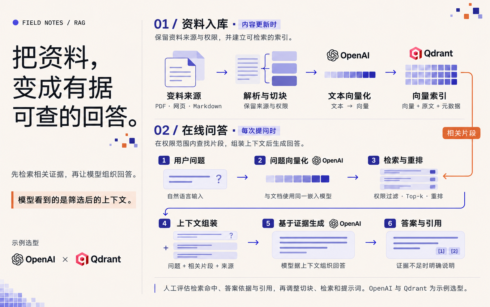
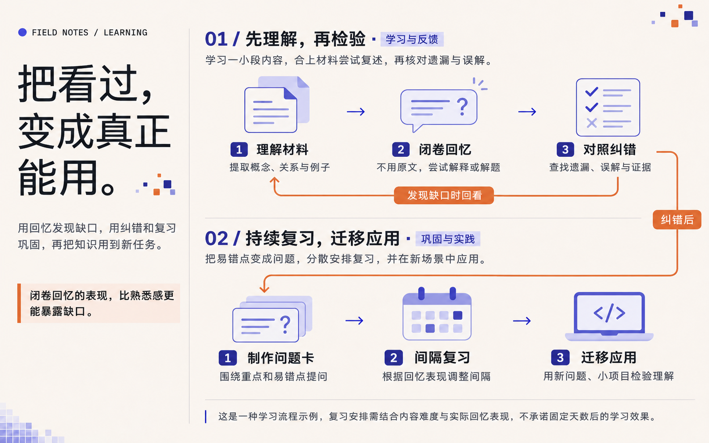

# yd-skills

个人常用的 AI Agent Skills，按用途分类整理。每个 Skill 都包含独立说明、所需资源和可选脚本。

## 技能目录

| 分类 | Skill | 用途 |
| --- | --- | --- |
| [illustration](skills/illustration/) | [yd-clear-article-illustrations](skills/illustration/yd-clear-article-illustrations/) | 白底黑线、橙蓝点缀的清爽手绘知识图解。 |
| [illustration](skills/illustration/) | [yd-editorial-tech-illustrations](skills/illustration/yd-editorial-tech-illustrations/) | 暖白底、靛蓝主色、陶土橙强调的编辑式技术图解。 |

## YD 编辑式技术图解

把技术文章、AI 教程或学习流程，整理成带有必要说明、明确重点和完整关系的中文配图。生成时会参考固定的色彩、排版和内容布局，并根据材料选用三种版式：

- **杂志式**：左侧标题、摘要与重点，右侧完整图解，适合文章配图和概念说明。
- **章节式**：按阶段展开解释，适合教程、方法和多段技术流程。
- **泳道式**：按角色或执行阶段分区，适合客户端/服务端、模型/工具等协作流程。

暖白、炭黑、靛蓝、灰蓝紫和少量陶土橙保持一致。正文保留必要解释；涉及专有工具时，可附上对应标识并保留工具名称。

### 图片示例

以下为该 Skill 经 Magpie Image 实际生成的原图，图片按实际输出尺寸 **1585×992** 展示。

#### 杂志式：RAG 检索增强生成

展示默认左文右图布局、配色和工具标识。此版本的跨行箭头没有准确落入“上下文组装”图形，作为风格示例展示，不作为关系正确的成图范例。



#### 杂志式：主动回忆与间隔复习

展示同一视觉体系在学习主题上的应用。六条流程关系通过本次人工核对；这是早期候选图，仍需按具体使用场景检查文字大小与审美。



#### 章节式：技术文章生产流程

展示章节母版如何表达选题、制作、发布与复盘。这是一次定向返修结果，10 条关系通过本次人工核查；同一主题的后续独立生成未稳定复现该结果。


### 使用方式

把 `skills/illustration/yd-editorial-tech-illustrations/` 目录安装到 Codex 的 Skill 目录 `~/.codex/skills/`（Windows 通常为 `%USERPROFILE%\.codex\skills\`），然后直接调用：

```text
使用 $yd-editorial-tech-illustrations，把这段 AI 教程做成中文技术配图。
保留必要解释和完整流程；默认左文右图，沿用固定暖白、靛蓝和陶土橙风格。
如果涉及具体工具，请在对应步骤旁展示工具名称和标识。
```

最好提供受众、用途、原文依据、核心结论、流程节点、节点说明以及各步骤之间的关系。比较图或概念图可以不使用流程箭头；未提供的工具、数据和性能结论不会作为事实添加。

### 验证状态

已经在 5 个主题和 3 种版式上完成多轮真实生成。暖白与靛蓝配色、基本文字层级和版式有重复性；复杂分支、跨区连线和反馈关系仍可能画错。每张图都需要核对文字、工具标识以及每条箭头的起点、终点和方向；多轮实测记录见 [Skill 验证说明](skills/illustration/yd-editorial-tech-illustrations/references/validation.md)。

本项目按以下成熟 Skill 仓库常用的 README 结构组织介绍：先说明用途与适用场景，再列安装和调用方式、资源结构与实测结果：[Anthropic Skills](https://github.com/anthropics/skills)、[Vercel Agent Skills](https://github.com/vercel-labs/agent-skills)。
