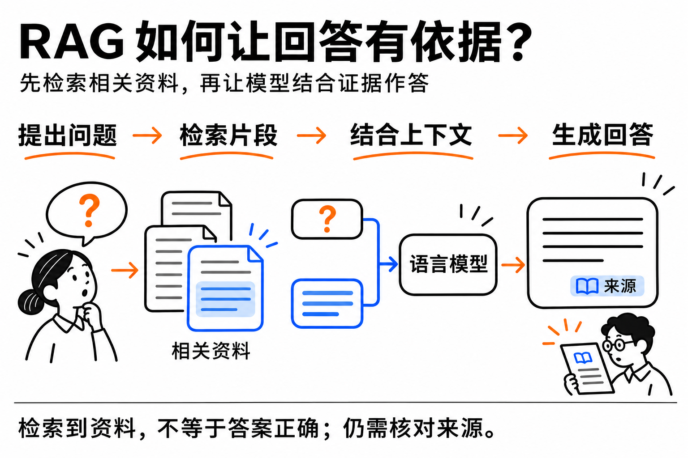

# yd-skills

个人常用的 Agent Skills 集合，按用途分类整理。每个 skill 独立存放，并在需要时附带参考资料与示例，方便复用和维护。

## 配图示例

### yd-clear-article-illustrations

面向技术文章、知识笔记和培训材料的配图 skill。先梳理内容关系，再选择合适的图解结构；以白底、清晰的黑色手绘线条和少量橙蓝强调呈现重点，人物按内容需要加入。

下面的示例用一页说明 RAG 如何结合检索资料生成回答，并提醒读者核对来源。



[查看 skill 说明](skills/illustration/yd-clear-article-illustrations/SKILL.md) · [查看风格参照说明](skills/illustration/yd-clear-article-illustrations/references/style-guide.md)

## Skills 分类

| 分类 | 适用内容 | Skill |
| --- | --- | --- |
| [插图与图解](skills/illustration/) | 文章配图、知识图解、技术培训插图 | [yd-clear-article-illustrations](skills/illustration/yd-clear-article-illustrations/) |

## 使用示例

安装对应 skill 后，可以直接描述内容和用途，例如：

> 使用 `yd-clear-article-illustrations`，把下面的技术内容整理成一页培训配图。先提炼核心结论和流程，只保留必要的中文标签；保持白底、黑色手绘线条和少量橙蓝强调，人物按内容需要出现。

随后附上需要讲解的文章段落、知识点或流程说明即可。复杂内容会优先拆分为多个重点，避免把过多信息挤进一张图。

## 目录结构

```text
skills/
└── illustration/
    └── yd-clear-article-illustrations/
        ├── SKILL.md
        ├── agents/
        ├── examples/
        └── references/
```
