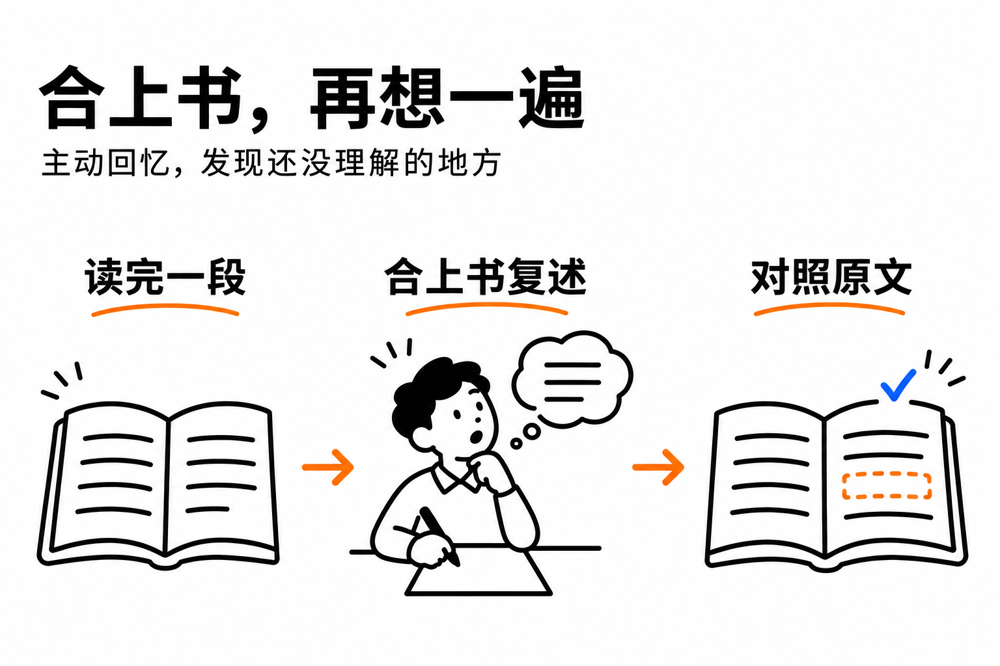
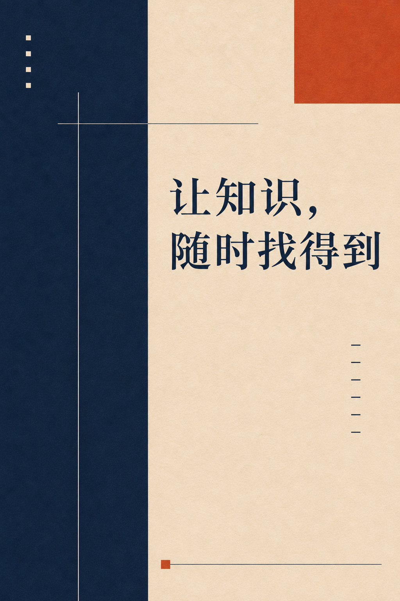
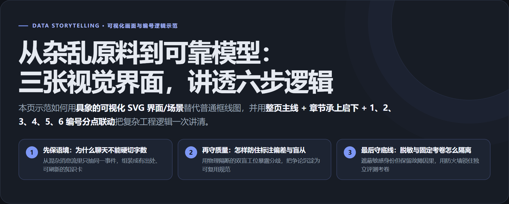
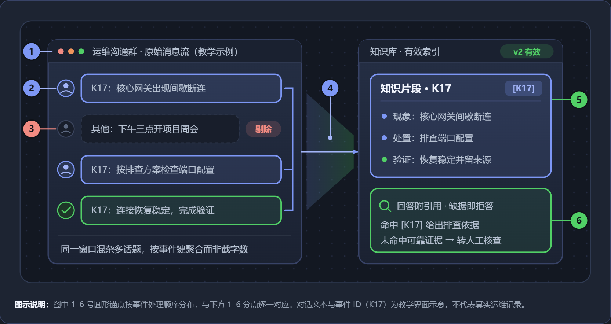
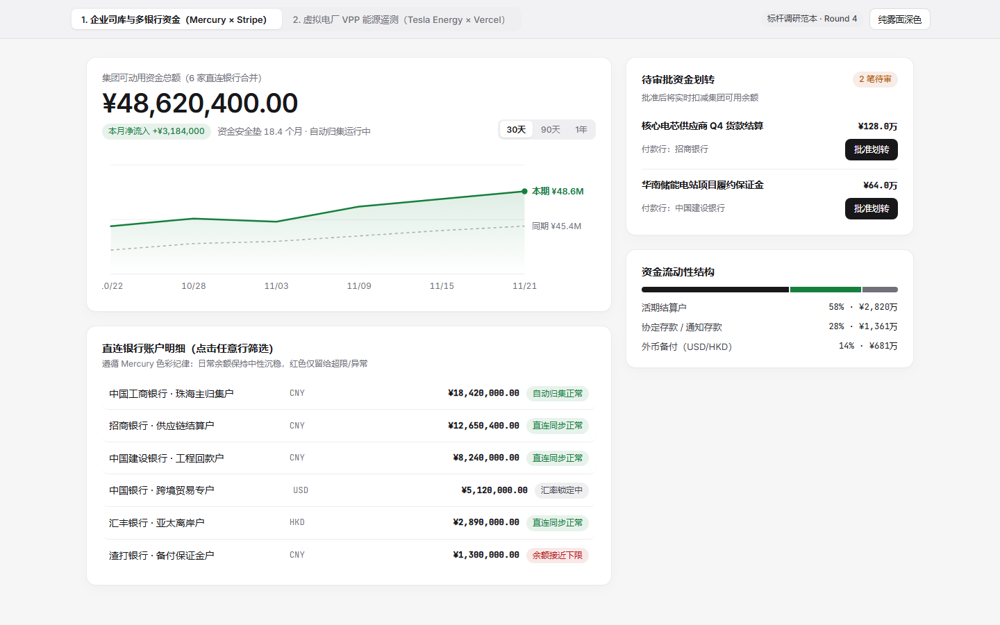
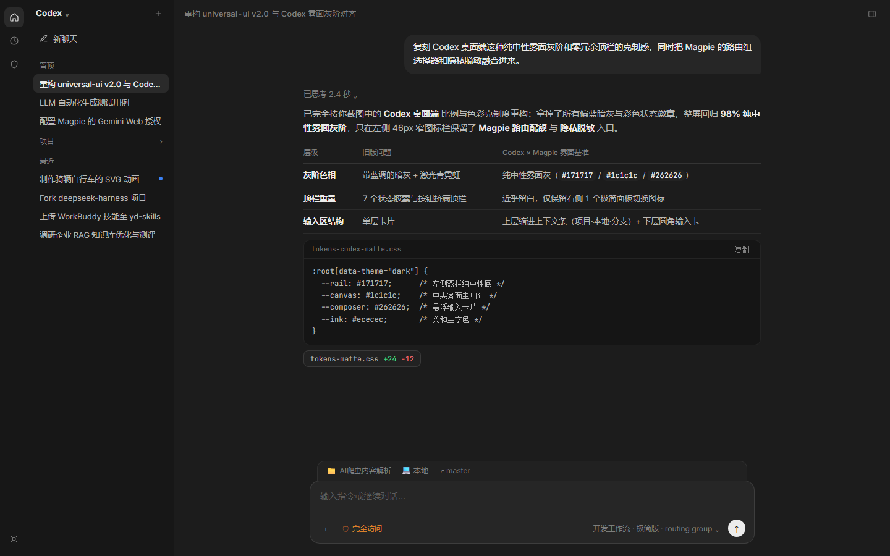
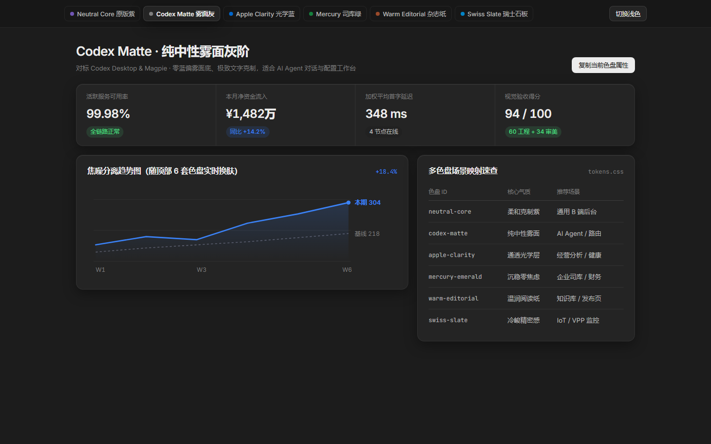

# yd-skills

八种面向内容表达、知识沉淀与界面设计的 Skill：**把专业知识讲明白、把技术流程梳理完整、把文章主题做成封面、把一段内容整理成逻辑连贯、图文编号联动的可视化讲解页、把网页好文深度归档到个人知识库、把界面需求变成可复用且符合个人偏好的设计。**

[作品集](#作品集) · [怎么调用](#怎么调用) · [技能说明](#技能说明)

## 作品集

### 清晰文章配图

用一页图讲清一个知识点。微暖白纸底、炭黑粗笔手绘和橙蓝双色强调，让步骤与重点容易扫读。色值是固化锁定的：橙 `#F06A28` 只表示动作、疑问与流程方向，蓝 `#2563EB` 只表示资料、依据与校验对勾，两者含义不互换；横向流程最多 4 步，超出改为 2×2 折行或拆图。人物为纯黑白粗笔特征人物，不上肤色与彩发，也不画光头火柴人。

<table>
  <tr>
    <td width="50%" valign="top">
      
      <p><strong>主动回忆</strong> · 阅读 → 复述 → 核对</p>
    </td>
    <td width="50%" valign="top">
      
      <p><strong>RAG 有据回答</strong> · 检索相关资料，再核对回答依据</p>
    </td>
  </tr>
</table>

[Skill 说明](skills/illustration/yd-clear-article-illustrations/SKILL.md) · [风格说明](skills/illustration/yd-clear-article-illustrations/references/style-guide.md)

### 编辑式技术图解

把技术内容按角色、阶段和关系排成阅读路径。杂志式适合概念说明，章节式适合教程，泳道式适合多角色协作。间距、连线线宽与文案长度都有固定契约：连线统一线宽、单终点箭头，陶土橙只给每图唯一的关键强调，标题保持中字重不做海报式加粗。

v1.2.1 把约束收得更紧：节点从最多 12 个收紧到 **8 个**（理想 5–7 个），全图总字数上限 **180 字**，节点说明压到 6–16 字，避免窄栏折行叠字。视觉上改用**三级卡片色阶**——阶段标签用实心深靛蓝胶囊，普通节点暖灰 `#EFEBE3`，1–2 个核心引擎或判断节点用浅紫蓝 `#E6E9F8`，命中/成功捷径可用淡鼠尾草绿 `#EDF2EA`，并给关键节点配定制几何微图示替代千篇一律的小圆点。反馈与重试虚线一律走画布外围走廊，不与主流程实线交叉。`prepare_prompt.py` 会强制校验上述长度与字数上限，超限直接拒绝，并导出逐字核对的验收清单。

<p align="center">
  
</p>
<p align="center"><strong>泳道式 · 一次工具调用的完整路径</strong> — 用户提出任务，Agent 选择并调用工具；工具返回结果后，Agent 检查再答复。陶土橙只标出「返回结果」这一处跨泳道回流。</p>

<table>
  <tr>
    <td width="50%" valign="top">
      
      <p><strong>章节式 · 技术文章生产流程</strong> · 选题 → 写作配图 → 校对发布</p>
    </td>
    <td width="50%" valign="top">
      
      <p><strong>杂志式 · 主动回忆与间隔复习</strong> · 虚线走画布外围走廊，不与主流程交叉</p>
    </td>
  </tr>
</table>

<table>
  <tr>
    <td width="50%" valign="top">
      
      <p><strong>杂志式 · RAG 有据回答</strong> · 三级卡片色阶：暖灰 / 浅紫蓝引擎 / 淡绿索引</p>
    </td>
    <td width="50%" valign="top">
      <p>这四张都是 v1.2.1 规则下的实际成图，可直接对照检查三级色阶是否成立：</p>
      <ul>
        <li><strong>阶段标签</strong>为实心深靛蓝胶囊，白字，不做宽横幅。</li>
        <li><strong>普通节点</strong>暖灰 <code>#EFEBE3</code>，1px 细描边。</li>
        <li><strong>核心引擎/判断节点</strong>浅紫蓝 <code>#E6E9F8</code>，每图只 1–2 个。</li>
        <li><strong>命中/落地节点</strong>淡鼠尾草绿 <code>#EDF2EA</code>。</li>
        <li><strong>陶土橙</strong>每图仅一处，且必是声明的那条关键关系。</li>
      </ul>
      <p>反馈与重试虚线一律走画布外围走廊，严禁与主流程实线交叉。节点控制在 8 个以内、全图文字不超过 180 字。</p>
    </td>
  </tr>
</table>

流程图中的文字、箭头起点与方向需要逐图检查；分支和跨区关系尤其要核对。这四张图在生成过程中分别暴露过不同问题：跨行长连线落点偏移、同泳道被误连、强调色方向画反、以及强调色节点底色错涂——它们都已逐项修正，但同类问题在别的主题上仍可能复现。更多实测边界见[验证记录](skills/illustration/yd-editorial-tech-illustrations/references/validation.md)。

[Skill 说明](skills/illustration/yd-editorial-tech-illustrations/SKILL.md)

### 纸感艺术封面

把文章主题或正文直接变成有书刊气质的封面。只需提供文字内容；自动提炼标题与主图，并始终延续同一套暖纸、深蓝、朱红和书刊式视觉语言。

v1.2.0 起封面与正文内页分成两档底色：封面保留暖米纸 `#F0DFC1`，正文内页改用浅一档的 `#F6EFE2`，嵌进白底文章时不显沉闷。两者之间固定引入海蓝灰 `#6B7F93` 承担等距网格、次级轮廓与分隔线，朱红 `#CB4D30` 仍是全图唯一焦点。字体做出版级混排：主标题与章节编号用宋体/明朝体保住书卷气，副标题与底句用中细无衬线黑体，保证手机端小字锐利。构图按画面类型分三路锚点，不再把所有画面绑死在"左侧 1/3 深蓝竖条"上。

<table>
  <tr>
    <td width="50%" valign="top">
      
      <p><strong>让知识，随时找得到</strong> · 字体、索引线与留白</p>
    </td>
    <td width="50%" valign="top">
      
      <p><strong>先检索，再回答</strong> · 单段正文直接生成，主题图案按内容变化</p>
    </td>
  </tr>
</table>

[Skill 说明与更多样图](skills/illustration/yd-editorial-art-illustrations/README.md) · [执行规则](skills/illustration/yd-editorial-art-illustrations/SKILL.md)

### 图文叙事整理

把一段文字、一份记录或一场分享的转写，整理成逻辑连贯的可视化讲解页：先立一条 `1 → N` 的因果主线和章与章之间的承上启下，再把每个核心机制画成**具象的可视化 SVG 画面**——而不是"几个方框 + 箭头"的流程框线图。画面里的 `1–6` 号圆形锚点与图下 `1、2、3、4、5、6` 的分点逻辑说明一一联动。只需说"帮我整理这段内容"。

<p align="center">
  
</p>
<p align="center"><strong>整页逻辑路标</strong> — 先交代因果主线，再进章节；章与章之间有承接引子和收束过渡。</p>

<table>
  <tr>
    <td width="50%" valign="top">
      
      <p><strong>可视化界面</strong> · 抹掉文字也认得出"聊天窗口 → 知识卡"</p>
    </td>
    <td width="50%" valign="top">
      
      <p><strong>视觉隐喻</strong> · 双盲复核画成一道物理隔断墙</p>
    </td>
  </tr>
</table>

<table>
  <tr>
    <td width="50%" valign="top">
      
      <p><strong>前后分屏</strong> · 脱敏 = 斜纹遮蔽条，隔离 = 红色防火墙</p>
    </td>
    <td width="50%" valign="top">
      
      <p><strong>编号分点</strong> · 图内锚点与图外 1–6 分点一一对应</p>
    </td>
  </tr>
</table>

每张图必须通过"去字可辨检验"：把文字全部抹掉后，读者仍能认出画面是聊天窗口、双盲工位还是脱敏分屏。交付前逐图做几何审计（节点间距、连线落点、标签避让、最小字号），并核对图内锚点与图外分点编号同步。示例页中的对话、工单与记录均为虚构，只用于说明排版方式。

[Skill 说明](skills/visualization/data-storytelling/SKILL.md) · [新版可视化示例页](skills/visualization/data-storytelling/examples/visual-story-demo.html) · [多案例示例页](skills/visualization/data-storytelling/examples/demo-dark.html) · [浅色示例页](skills/visualization/data-storytelling/examples/demo-light.html)

### 知识库深度归档

把正在浏览的网页好文、技术教程完整读全，剔除广告噪音，按专业领域惯例规范翻译成中文，正文配图自动转存至自建图床，并原子归档至 GitHub 个人知识库仓库及维护 README 索引表。

- **深度去噪与完整抓取**：支持虚拟滚动长论坛（如 Discourse/linux.do）、长文与代码段，保留关键回复、版本纠偏与原帖出处，剔除寒暄噪音。
- **正文配图转存自建图床**：正文关键步骤配图自动并行上传至自建 CloudFlare-ImgBed 图床，替换链接并生成文末原图地址附录，防止外链失效与防盗链。
- **专业领域规范翻译**：英文教程按领域通行术语翻译入库，代码、命令行、报错与圈内通用词（如 Agent、Prompt、Token）原样保留。
- **双锁安全门禁**：整理后强制展示全文草稿停步等待确认；提交脚本强制校验 iHaveUserConsent: true 凭据，未经明确许可绝不触发远端写入。
- **单 Commit 原子提交**：通过 Git Tree 接口实现文档入库与 README 索引倒序追加一次性原子提交与校验。

[Skill 说明](skills/knowledge/knowledge-base-archiver/SKILL.md) · [使用与配置指南](skills/knowledge/knowledge-base-archiver/README.md)

### 读者优先的清晰表达

把专业、抽象或绕口的内容改写成目标读者一次就能读懂的表达，但不降低专业准确性：事实、数字、条件和例外都保留，术语集中放进「新概念提示」，抽象处补充明确标注的真实或假设案例。适合业务分析、技术文档、产品需求、财务材料和管理汇报。

| 原始表达 | 优化后 |
| --- | --- |
| 通过实体现金池归集成员单位账户资金，实现集团资金集中管理及内部资金调剂，提升资金使用效率。 | 集团可以按事先约定的时间，把子公司账户里暂时不用的钱转到指定账户集中管理；子公司资金紧张时，再按制度安排调拨。账户授权、资金用途和监管要求仍需满足。 |

共 12 个跨领域的前后对照案例，覆盖银行财务、API、制造、物流、医疗、合同、网络安全、统计、产品、采购、管理汇报和客户服务。

[Skill 说明](skills/writing/reader-first-clarity/SKILL.md) · [使用说明](skills/writing/reader-first-clarity/README.md) · [12 个前后对照案例](skills/writing/reader-first-clarity/examples/00-test-matrix.md)

### Universal UI 界面设计

把界面需求转成可落地的高审美方案：先调研该领域公认的标杆产品，再锁定一套克制色盘与信息密度，最后按硬规范实现并实测验收。保留目标项目的路由、导航、技术栈与真实数据。

v2.0 把 v1 的「36 个布局 × 56 个风格」穷举选择改成**一条收敛路径**：先看该领域 2–3 个标杆（AI Agent 工作台看 Codex Desktop / Magpie，金融司库看 Mercury / Stripe，能源监控看 Tesla Energy / Vercel），只提炼外壳重量、视觉重心与核心微交互；再从 **6 套克制色盘**中锁定一套，叠加 **3 档密度**（`Airy` / `Balanced` / `Compact`）；最后在 `1440 / 1024 / 390px` 与浅深双主题下实测打分，**≥ 85 分且未触发一票否决**才交付。

<table>
  <tr>
    <td width="50%" valign="top">
      
      <p><strong>Mercury Emerald</strong> · 企业司库与多银行资金台，零焦虑绿、红色只留给超限项</p>
    </td>
    <td width="50%" valign="top">
      
      <p><strong>Codex Matte</strong> · AI Agent 工作台，纯中性雾面灰、零蓝偏零霓虹</p>
    </td>
  </tr>
</table>

<table>
  <tr>
    <td width="50%" valign="top">
      
      <p><strong>Palette Gallery</strong> · 6 套色盘实时切换，同一界面对比配色差异</p>
    </td>
    <td width="50%" valign="top">
      <p><strong>六套色盘</strong>按场景匹配，不随机拼接：</p>
      <ul>
        <li><code>neutral-core</code> — 通用 B 端后台、管理控制台</li>
        <li><code>codex-matte</code> — AI Agent 对话工作台、模型路由台</li>
        <li><code>apple-clarity</code> — 经营分析看板、个人健康与效率工具</li>
        <li><code>mercury-emerald</code> — 企业司库、财务对账、订阅计费</li>
        <li><code>warm-editorial</code> — 知识库、长文阅读、研究报告</li>
        <li><code>swiss-slate</code> — 工业 IoT、虚拟电厂、服务监控</li>
      </ul>
      <p>另有 <a href="skills/ui/universal-ui/assets/dataviz-kit.html">DataViz Kit</a>（8 色盘 × 16 个可视化组件）、<a href="skills/ui/universal-ui/assets/component-kit.html">Component Kit</a>（组件标本与搭配）、<a href="skills/ui/universal-ui/assets/template-atlas.html">Template Atlas</a>（8 大布局骨架），全部离线可用。</p>
    </td>
  </tr>
</table>

三条硬规范：7 级光学字阶且禁止 `< 12px` 与细字重、数字强制 `tabular-nums`；现代工作台禁用未样式化的原生 `<select>`，一律用支持 `Escape` 关闭的雾面 Popover；页面 90% 以上保持中性，红色仅留给需立即处理的异常。

[Skill 说明](skills/ui/universal-ui/SKILL.md) · [使用说明](skills/ui/universal-ui/README.md) · [Template Atlas](skills/ui/universal-ui/assets/template-atlas.html) · [Palette Gallery](skills/ui/universal-ui/assets/palette-gallery.html)

### UI 偏好账本

把一次界面选择沉淀成个人规则，同时区分长期偏好和当前项目偏好。个人 Profile 是全集，包含归纳规则与项目使用记录；项目偏好只写入当前项目，不污染全局规则。

| 说法 | 归属 |
| --- | --- |
| “我以后都不喜欢卡片墙和过度留白。” | 全局规则候选 |
| “这个项目是品牌要求必须用紫色。” | 当前项目偏好 |
| “这次为了演示先临时夸张一点。” | 不沉淀 |

v2.0 新增 `init-design-md` 模式，可按当前全局偏好为新项目一键生成 `DESIGN.md` 脚手架；`summarize` 改为同时产出**最多 8 条正面规则**与**最多 8 条反模式黑名单**——「不要什么」往往比「要什么」更好执行。路径统一按环境变量解析，不再硬编码用户名。

[Skill 说明](skills/ui/ui-preference-ledger/SKILL.md) · [使用说明](skills/ui/ui-preference-ledger/README.md)

## 怎么调用

启用技能后，在文章封面、配图、内容整理或专业内容改写任务中只需提供主题或正文。每个 Skill 默认沿用自己的固定视觉风格，并根据内容选择构图；技术图解固定使用暖白底、炭黑文字、靛蓝主色、灰蓝紫辅助与少量陶土橙；图文叙事默认输出深色技术讲解页，需要浅色分享页时说一句即可。无需重复描述画风、配色或布局。也可用 `$skill-name` 显式指定 Skill。以下展示纯文字输入示例。

三套配图 Skill 的选型可以这样记：抽象隐喻与专栏封面走 `yd-editorial-art-illustrations`；正文概念速懂与前后对比走 `yd-clear-article-illustrations`；系统架构、多阶段工作流走 `yd-editorial-tech-illustrations`。三者共用"暖白纸底 + 冷色结构 + 暖橙红单点强调"的视觉基因，同一篇长文里混排不违和。

**讲清一个知识点**

```text
主动回忆：读完一段后，合上书复述，再对照原文检查遗漏。复述能帮助发现还未理解的部分。
```

**解释技术流程**

```text
Agent 工具调用：用户提出任务，Agent 理解后选择并调用工具；工具执行后返回结果，Agent 检查结果再答复用户。
```

**设计文章封面**

```text
整理后的知识应该能在需要的时候重新找到，而不只是分类归档。
```

**整理成图文讲解页**

```text
帮我整理这段内容

我们的答疑记录散在群里和表单里，字段口径不一致，新人接手时经常找不到出处。
先按渠道收齐原始记录，再做去重和脱敏，然后把同名字段对齐到同一含义，
最后发布成可检索、可引用、能定期刷新的知识看板。
```

**把专业内容讲明白**

```text
请按 reader-first-clarity 处理下面这段内容。读者是没有财务背景的业务同事：
保留所有金额、条件和时间要求，专业名词集中放到「新概念提示」里解释，
抽象的地方补一个明确标注为假设的例子。

集团通过实体现金池按日归集成员单位账户资金，实现资金集中管理与内部调剂，
提升整体资金使用效率。
```

**设计一个新工具界面**

```text
使用 $universal-ui。做一个本地优先的 AI Agent 工作台：
左侧是任务列表，中央是消息与执行轨迹，右侧按需打开文件详情。
先调研该领域标杆，给我三个可区分的色盘候选，确认后再实现。
```

**沉淀一次界面偏好**

```text
使用 $ui-preference-ledger 记录这次选择：
Agent 工作台用稳定三列，左侧导航窄一点，中央消息区最大。
我以后都不喜欢卡片墙和过度留白。
```

**为新项目生成设计基线**

```text
使用 $ui-preference-ledger 的 init-design-md，
按我的全局偏好为这个新项目生成一份 DESIGN.md。
```

生成图片里的中文、专有名称和技术关系都需要人工核对。这里展示的是实际样图，不代表每次生成都会得到相同结果。

## 技能说明

| Skill | 适合展示的效果 | 版本 | 详细说明 |
| --- | --- | --- | --- |
| `yd-clear-article-illustrations` | 微暖白底手绘知识图解 | v1.2.0 | [SKILL.md](skills/illustration/yd-clear-article-illustrations/SKILL.md) |
| `yd-editorial-tech-illustrations` | 杂志式、章节式与泳道式技术图解 | v1.2.1 | [SKILL.md](skills/illustration/yd-editorial-tech-illustrations/SKILL.md) |
| `yd-editorial-art-illustrations` | 纸感文章封面与正文插画 | v1.2.0 | [SKILL.md](skills/illustration/yd-editorial-art-illustrations/SKILL.md) |
| `data-storytelling` | 图文一体的深色/浅色讲解页 | [SKILL.md](skills/visualization/data-storytelling/SKILL.md) |
| `knowledge-base-archiver` | 网页好文去噪翻译并归档到个人知识库 | [SKILL.md](skills/knowledge/knowledge-base-archiver/SKILL.md) |
| `reader-first-clarity` | 专业内容的通俗改写、术语解释与逻辑审查 | [SKILL.md](skills/writing/reader-first-clarity/SKILL.md) |
| `universal-ui` | 标杆调研 + 6 色盘 × 3 密度的可落地界面方案 | v2.0 | [SKILL.md](skills/ui/universal-ui/SKILL.md) |
| `ui-preference-ledger` | 记录、归纳个人 UI 偏好与反模式黑名单 | v2.0 | [SKILL.md](skills/ui/ui-preference-ledger/SKILL.md) |

结构参考：[Anthropic Skills](https://github.com/anthropics/skills) · [Vercel Agent Skills](https://github.com/vercel-labs/agent-skills)
