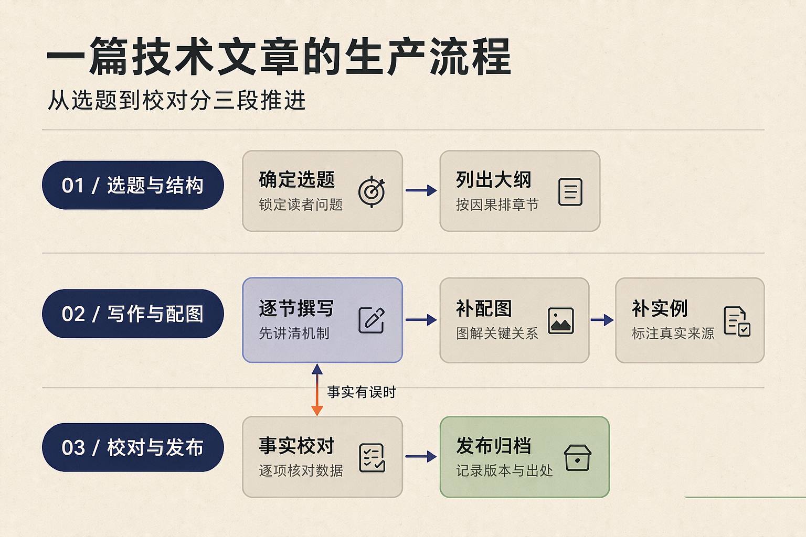
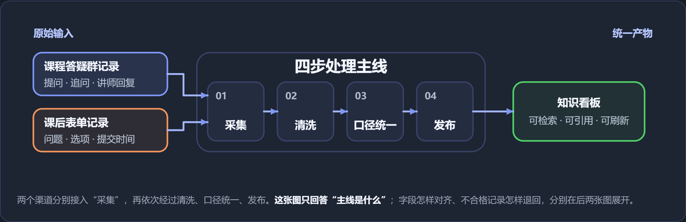

# yd-skills

六种面向内容表达与知识沉淀的 Skill：**把专业知识讲明白、把技术流程梳理完整、把文章主题做成封面、把一段内容整理成图文讲解页、把网页好文深度归档到个人知识库。**

[作品集](#作品集) · [怎么调用](#怎么调用) · [技能说明](#技能说明)

## 作品集

### 清晰文章配图

用一页图讲清一个知识点。白底、手绘黑线和少量橙蓝强调，让步骤与重点容易扫读。

<table>
  <tr>
    <td width="50%" valign="top">
      
      <p><strong>主动回忆</strong> · 阅读 → 复述 → 核对</p>
    </td>
    <td width="50%" valign="top">
      
      <p><strong>RAG 有据回答</strong> · 检索相关资料，再核对回答依据</p>
    </td>
  </tr>
</table>

[Skill 说明](skills/illustration/yd-clear-article-illustrations/SKILL.md) · [风格说明](skills/illustration/yd-clear-article-illustrations/references/style-guide.md)

### 编辑式技术图解

把技术内容按角色、阶段和关系排成阅读路径。杂志式适合概念说明，章节式适合教程，泳道式适合多角色协作。

<p align="center">
  
</p>
<p align="center"><strong>泳道式 · Agent 工具调用</strong> — 用户提出任务，Agent 调用工具并检查返回结果。</p>

<table>
  <tr>
    <td width="50%" valign="top">
      
      <p><strong>章节式 · 技术文章生产流程</strong></p>
    </td>
    <td width="50%" valign="top">
      
      <p><strong>杂志式 · 主动回忆与间隔复习</strong></p>
    </td>
  </tr>
</table>

流程图中的文字、箭头起点与方向需要逐图检查；分支和跨区关系尤其要核对。更多实测边界见[验证记录](skills/illustration/yd-editorial-tech-illustrations/references/validation.md)。

[Skill 说明](skills/illustration/yd-editorial-tech-illustrations/SKILL.md)

### 纸感艺术封面

把文章主题或正文直接变成有书刊气质的封面。只需提供文字内容；自动提炼标题与主图，并始终延续同一套暖纸、深蓝、朱红和书刊式视觉语言。

<table>
  <tr>
    <td width="50%" valign="top">
      
      <p><strong>让知识，随时找得到</strong> · 字体、索引线与留白</p>
    </td>
    <td width="50%" valign="top">
      
      <p><strong>先检索，再回答</strong> · 单段正文直接生成，主题图案按内容变化</p>
    </td>
  </tr>
</table>

[Skill 说明与更多样图](skills/illustration/yd-editorial-art-illustrations/README.md) · [执行规则](skills/illustration/yd-editorial-art-illustrations/SKILL.md)

### 图文叙事整理

把一段文字、一份记录或一场分享的转写，整理成“图 + 文”的讲解结构：一句主结论、一张主线总览、每个独立关系单独一张 SVG、逐项配图的判断表与执行清单。只需说“帮我整理这段内容”。

<table>
  <tr>
    <td width="50%" valign="top">
      
      <p><strong>主线总览</strong> · 一张图只回答“主线是什么”</p>
    </td>
    <td width="50%" valign="top">
      
      <p><strong>分叉判断</strong> · 两条箭头指向两个去向，图注写明边界</p>
    </td>
  </tr>
</table>

图按“一个关系一张”拆分，交付前逐图做几何审计（节点间距、连线落点、标签避让、最小字号）和整页覆盖核对。示例页中的团队、渠道与数值均为虚构，只用于说明排版方式。

[Skill 说明](skills/visualization/data-storytelling/SKILL.md) · [深色示例页](skills/visualization/data-storytelling/examples/demo-dark.html) · [浅色示例页](skills/visualization/data-storytelling/examples/demo-light.html)

### 知识库深度归档

把正在浏览的网页好文、技术教程完整读全，剔除广告噪音，按专业领域惯例规范翻译成中文，正文配图自动转存至自建图床，并原子归档至 GitHub 个人知识库仓库及维护 README 索引表。

- **深度去噪与完整抓取**：支持虚拟滚动长论坛（如 Discourse/linux.do）、长文与代码段，保留关键回复、版本纠偏与原帖出处，剔除寒暄噪音。
- **正文配图转存自建图床**：正文关键步骤配图自动并行上传至自建 CloudFlare-ImgBed 图床，替换链接并生成文末原图地址附录，防止外链失效与防盗链。
- **专业领域规范翻译**：英文教程按领域通行术语翻译入库，代码、命令行、报错与圈内通用词（如 Agent、Prompt、Token）原样保留。
- **双锁安全门禁**：整理后强制展示全文草稿停步等待确认；提交脚本强制校验 iHaveUserConsent: true 凭据，未经明确许可绝不触发远端写入。
- **单 Commit 原子提交**：通过 Git Tree 接口实现文档入库与 README 索引倒序追加一次性原子提交与校验。

[Skill 说明](skills/knowledge/knowledge-base-archiver/SKILL.md) · [使用与配置指南](skills/knowledge/knowledge-base-archiver/README.md)

### 读者优先的清晰表达

把专业、抽象或绕口的内容改写成目标读者一次就能读懂的表达，但不降低专业准确性：事实、数字、条件和例外都保留，术语集中放进「新概念提示」，抽象处补充明确标注的真实或假设案例。适合业务分析、技术文档、产品需求、财务材料和管理汇报。

| 原始表达 | 优化后 |
| --- | --- |
| 通过实体现金池归集成员单位账户资金，实现集团资金集中管理及内部资金调剂，提升资金使用效率。 | 集团可以按事先约定的时间，把子公司账户里暂时不用的钱转到指定账户集中管理；子公司资金紧张时，再按制度安排调拨。账户授权、资金用途和监管要求仍需满足。 |

共 12 个跨领域的前后对照案例，覆盖银行财务、API、制造、物流、医疗、合同、网络安全、统计、产品、采购、管理汇报和客户服务。

[Skill 说明](skills/writing/reader-first-clarity/SKILL.md) · [使用说明](skills/writing/reader-first-clarity/README.md) · [12 个前后对照案例](skills/writing/reader-first-clarity/examples/00-test-matrix.md)

## 怎么调用

启用技能后，在文章封面、配图、内容整理或专业内容改写任务中只需提供主题或正文。每个 Skill 默认沿用自己的固定视觉风格，并根据内容选择构图；技术图解固定使用暖白底、炭黑文字、靛蓝主色、灰蓝紫辅助与少量陶土橙；图文叙事默认输出深色技术讲解页，需要浅色分享页时说一句即可。无需重复描述画风、配色或布局。也可用 `$skill-name` 显式指定 Skill。以下展示纯文字输入示例。

**讲清一个知识点**

```text
主动回忆：读完一段后，合上书复述，再对照原文检查遗漏。复述能帮助发现还未理解的部分。
```

**解释技术流程**

```text
Agent 工具调用：用户提出任务，Agent 理解后选择并调用工具；工具执行后返回结果，Agent 检查结果再答复用户。
```

**设计文章封面**

```text
整理后的知识应该能在需要的时候重新找到，而不只是分类归档。
```

**整理成图文讲解页**

```text
帮我整理这段内容

我们的答疑记录散在群里和表单里，字段口径不一致，新人接手时经常找不到出处。
先按渠道收齐原始记录，再做去重和脱敏，然后把同名字段对齐到同一含义，
最后发布成可检索、可引用、能定期刷新的知识看板。
```

**把专业内容讲明白**

```text
请按 reader-first-clarity 处理下面这段内容。读者是没有财务背景的业务同事：
保留所有金额、条件和时间要求，专业名词集中放到「新概念提示」里解释，
抽象的地方补一个明确标注为假设的例子。

集团通过实体现金池按日归集成员单位账户资金，实现资金集中管理与内部调剂，
提升整体资金使用效率。
```

生成图片里的中文、专有名称和技术关系都需要人工核对。这里展示的是实际样图，不代表每次生成都会得到相同结果。

## 技能说明

| Skill | 适合展示的效果 | 详细说明 |
| --- | --- | --- |
| `yd-clear-article-illustrations` | 白底手绘知识图解 | [SKILL.md](skills/illustration/yd-clear-article-illustrations/SKILL.md) |
| `yd-editorial-tech-illustrations` | 杂志式、章节式与泳道式技术图解 | [SKILL.md](skills/illustration/yd-editorial-tech-illustrations/SKILL.md) |
| `yd-editorial-art-illustrations` | 纸感文章封面与正文插画 | [SKILL.md](skills/illustration/yd-editorial-art-illustrations/SKILL.md) |
| `data-storytelling` | 图文一体的深色/浅色讲解页 | [SKILL.md](skills/visualization/data-storytelling/SKILL.md) |
| `knowledge-base-archiver` | 网页好文去噪翻译并归档到个人知识库 | [SKILL.md](skills/knowledge/knowledge-base-archiver/SKILL.md) |
| `reader-first-clarity` | 专业内容的通俗改写、术语解释与逻辑审查 | [SKILL.md](skills/writing/reader-first-clarity/SKILL.md) |

结构参考：[Anthropic Skills](https://github.com/anthropics/skills) · [Vercel Agent Skills](https://github.com/vercel-labs/agent-skills)
