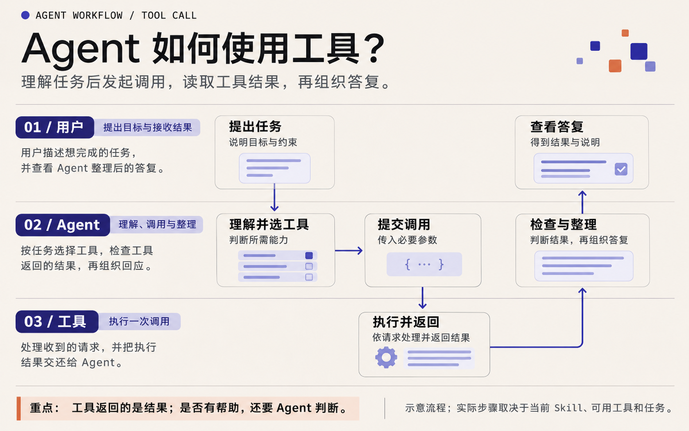

# yd-skills

三种面向内容表达的图像 Skill：**把知识讲清楚、把技术流程梳理完整、把文章主题做成封面。**

[作品集](#作品集) · [怎么调用](#怎么调用) · [技能说明](#技能说明)

## 作品集

### 清晰文章配图

用一页图讲清一个知识点。白底、手绘黑线和少量橙蓝强调，让步骤与重点容易扫读。

<table>
  <tr>
    <td width="50%" valign="top">
      
      <p><strong>主动回忆</strong> · 阅读 → 复述 → 核对</p>
    </td>
    <td width="50%" valign="top">
      
      <p><strong>RAG 有据回答</strong> · 检索相关资料，再核对回答依据</p>
    </td>
  </tr>
</table>

[Skill 说明](skills/illustration/yd-clear-article-illustrations/SKILL.md) · [风格说明](skills/illustration/yd-clear-article-illustrations/references/style-guide.md)

### 编辑式技术图解

把技术内容按角色、阶段和关系排成阅读路径。杂志式适合概念说明，章节式适合教程，泳道式适合多角色协作。

<p align="center">
  
</p>
<p align="center"><strong>泳道式 · Agent 工具调用</strong> — 用户提出任务，Agent 调用工具并检查返回结果。</p>

<table>
  <tr>
    <td width="50%" valign="top">
      
      <p><strong>章节式 · 技术文章生产流程</strong></p>
    </td>
    <td width="50%" valign="top">
      
      <p><strong>杂志式 · 主动回忆与间隔复习</strong></p>
    </td>
  </tr>
</table>

流程图中的文字、箭头起点与方向需要逐图检查；分支和跨区关系尤其要核对。更多实测边界见[验证记录](skills/illustration/yd-editorial-tech-illustrations/references/validation.md)。

[Skill 说明](skills/illustration/yd-editorial-tech-illustrations/SKILL.md)

### 纸感艺术封面

把文章主旨变成有书刊气质的封面。保留暖纸、深蓝和少量朱红；抽象的字体、色块和线条优先，主题需要时再用具象图案。

<table>
  <tr>
    <td width="50%" valign="top">
      
      <p><strong>让知识，随时找得到</strong> · 字体、索引线与留白</p>
    </td>
    <td width="50%" valign="top">
      
      <p><strong>一条灵感，四种表达</strong> · 同一主题，多种媒介</p>
    </td>
  </tr>
</table>

[Skill 说明与更多样图](skills/illustration/yd-editorial-art-illustrations/README.md) · [执行规则](skills/illustration/yd-editorial-art-illustrations/SKILL.md)

## 怎么调用

在能识别这些 Skill 的 Agent 对话里，用 `$skill-name` 开始描述任务。给出主题、结论和用途；技术图补上节点及连线，封面补上准确标题。下面是可以直接改写的提示词。

**讲清一个知识点**

```text
使用 $yd-clear-article-illustrations，把“主动回忆”做成一张文章配图。
核心结论：合上书复述，能发现还没理解的部分。
按“读完一段 → 合上书复述 → 对照原文”组织，突出白底黑线和少量橙蓝。
请检查标签文字和箭头方向。
```

**解释技术流程**

```text
使用 $yd-editorial-tech-illustrations，用 lanes 版式说明 Agent 工具调用。
角色：用户、Agent、工具。
顺序：用户提出任务 → Agent 理解并选工具 → 提交调用 → 工具执行并返回 → Agent 检查结果并答复。
按这些关系连线，不添加额外步骤。
```

**设计文章封面**

```text
使用 $yd-editorial-art-illustrations，制作 2:3 文章封面。
标题：让知识，随时找得到
主旨：整理后的知识应当容易重新找到。
采用纯抽象表达，不画实体物件；用标题字级、深蓝短线、间隔变化和少量朱红标记表现“索引与再发现”。保留暖纸质感与留白。
```

生成图片里的中文、专有名称和技术关系都需要人工核对。这里展示的是实际样图，不代表每次生成都会得到相同结果。

## 技能说明

| Skill | 适合展示的效果 | 详细说明 |
| --- | --- | --- |
| `yd-clear-article-illustrations` | 白底手绘知识图解 | [SKILL.md](skills/illustration/yd-clear-article-illustrations/SKILL.md) |
| `yd-editorial-tech-illustrations` | 杂志式、章节式与泳道式技术图解 | [SKILL.md](skills/illustration/yd-editorial-tech-illustrations/SKILL.md) |
| `yd-editorial-art-illustrations` | 纸感文章封面与正文插画 | [SKILL.md](skills/illustration/yd-editorial-art-illustrations/SKILL.md) |

结构参考：[Anthropic Skills](https://github.com/anthropics/skills) · [Vercel Agent Skills](https://github.com/vercel-labs/agent-skills)
