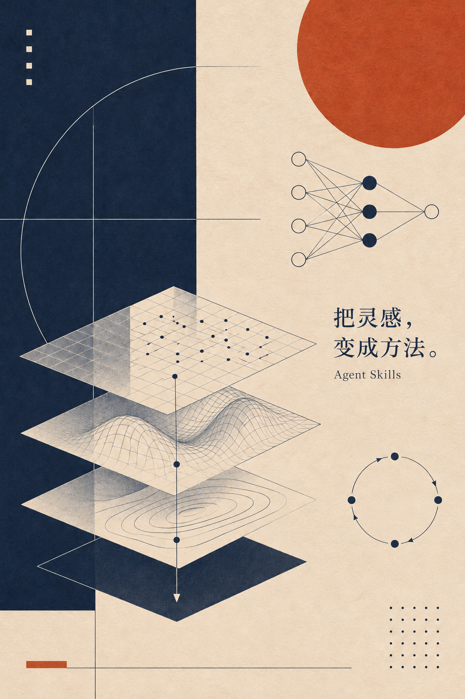

# YD 纸感艺术文章配图

**Skill 名称：`yd-editorial-art-illustrations`** · 分类：`illustration`（插画与文章配图）

为文章、学习笔记和知识内容制作有书刊气质的封面及正文插画。沿用暖米白纸面、深海军蓝结构色、少量朱红、精细印刷线稿与宋体视觉。封面优先尝试纯抽象的字体、线条、色块与留白；主题需要或用户提出时，再用具象物件作隐喻。

## 能做什么

- 根据文章主旨设计抽象或具象封面，支持已定标题，也可先拟定简短标题。
- 在同一视觉体系内制作系列文章配图，变化主图、小图案和文字结构。
- 制作带必要解释、步骤或输入输出的正文插画。
- 使用当前环境可用的图像工具生成；用户指定 Magpie Image MCP 时可使用该工具。
- 生成后查看图片，核对文字、图案含义、可读性及与基准风格的关系。

这套风格以艺术插画和图文编排为中心。需要严格流程母版与密集技术关系时，也可查看同仓库的 [yd-editorial-tech-illustrations](../yd-editorial-tech-illustrations/)。

## 输入、流程和输出

| 项目 | 内容 |
| --- | --- |
| 必要输入 | 文章主题或已有正文。 |
| 推荐输入 | 一句话核心观点、准确标题、少量辅助文字、受众、用途、比例、抽象或具象偏好，以及想用或避开的图案。 |
| 处理流程 | 提炼主旨 → 选择抽象或具象表达 → 一起规划图文 → 附上基准生成 → 查看并针对性返修。 |
| 图片输出 | 实际生成的 PNG 或工具支持的图片格式，并报告真实尺寸。 |
| 随附说明 | 图案与文章的对应、提示词、文件位置，以及仍需处理的问题。 |

默认竖版 2:3；其他比例会重新构图。未提供准确标题时，可根据主题先拟标题；不会把缺失的文章事实、数据和技术结论编造成已验证内容。

## 图片与效果

以下均为实际生成的图片样张。风格基准用于观察配色和纸感，不要求复制其中的实体图案；其他主题、工具或比例仍需逐张检查。

### 抽象封面：让知识，随时找得到

以字体层级、深蓝短线、朱红定位标记和留白表达知识索引，不依赖实体物件。该图展示抽象表达方向，不替换风格基准。


### 风格基准：把灵感，变成方法

用于观察暖米白、深海军蓝、朱红、细线、纸纹与克制文字的整体关系。它是默认风格参考；其中的叠层、节点与圆环不是每张图的必选元素。



### 不同图案：一条灵感，四种表达

同一套配色下，以刊页、胶片格、索引卡和波形分别呼应文章、视频、卡片与音频。展示主图和小图案可以明显变化；这是探索样张，不替换风格基准。


### 正文内页：从指令到方法

展示标题、解释文字与「输入、执行、校验」三个阶段的对应。它保留了早期的叠层插画；新主题会另选合适主体，不强制沿用该图案。


## 调用

```text
使用 $yd-editorial-art-illustrations，为知识管理主题做一张 2:3 文章封面。
核心观点：整理后的知识应该容易重新找到。
采用纯抽象表达，不画实体物件；用标题字级、短线、间隔变化和少量朱红标记构成视觉索引。
标题：“让知识，随时找得到”。沿用暖纸、深蓝和少量朱红，保留留白。
```

```text
使用 $yd-editorial-art-illustrations，为下面的文章制作一张正文配图。
解释“输入 → 执行 → 校验”，每一步保留一句必要说明。
保持参考的纸感和配色，可用简明线条与色块组织步骤，不必加入实体物件。
如果当前可用，使用 Magpie Image MCP 生成，并检查最终中文。
```

更多输入方式见 [提示词模板](references/prompt-patterns.md)。

## 包内资源

```text
yd-editorial-art-illustrations/
├── SKILL.md
├── README.md
├── agents/openai.yaml
├── references/
│   ├── style-guide.md
│   ├── prompt-patterns.md
│   └── style-anchor.png
└── assets/examples/
    ├── content-repurposing.png
    ├── knowledge-index-abstract-cover.png
    └── skill-interior.png
```

## 使用边界

文字和字体由图像模型绘制，仍可能有错字；每次都需要核对实际成图。细线与小字在缩略图下可能不清楚，应根据发布尺寸调整。PNG 是位图，不包含可编辑文字或矢量图层。

基准图与样张用于复用视觉方向；不能据此承诺每次生成完全一致。图解中的技术关系也需要按文章核对，艺术表达不能替代事实验证。
