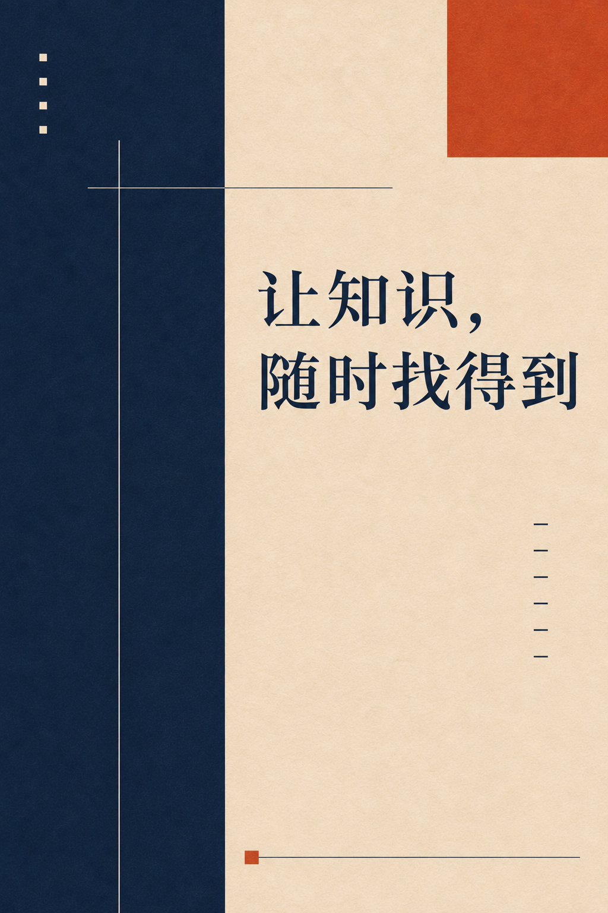
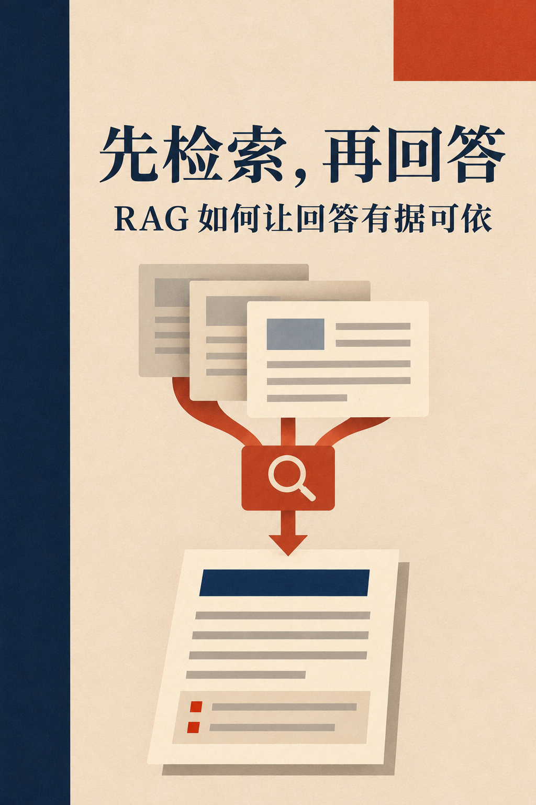

# YD 纸感艺术文章配图

**Skill 名称：`yd-editorial-art-illustrations`** · 分类：`illustration`（插画与文章配图）

根据文章主题或正文直接制作有书刊气质的封面及正文插画。所有输出统一沿用暖米白纸面、深海军蓝结构色、少量朱红、印刷质感和宋体视觉；主体图案与构图随内容变化。用户只需提供文字内容，不必另外编写风格提示词。

## 能做什么

- 根据用户提供的文章或主题文字，自动提炼标题与主图并生成封面；给出准确标题时按原文保留。
- 在同一视觉体系内制作系列文章配图，变化主图、小图案和文字结构。
- 制作带必要解释、步骤或输入输出的正文插画。
- 使用当前环境可用的图像工具生成；用户指定 Magpie Image MCP 时可使用该工具。
- 生成后查看图片，核对文字、图案含义、可读性及与基准风格的关系。

这套风格以艺术插画和图文编排为中心。需要严格流程母版与密集技术关系时，也可查看同仓库的 [yd-editorial-tech-illustrations](../yd-editorial-tech-illustrations/)。

## 输入、流程和输出

| 项目 | 内容 |
| --- | --- |
| 必要输入 | 用户希望呈现的文章、标题、主题段落或其他文字内容。 |
| 可选输入 | 准确标题、特定尺寸、明确要保留或避开的内容。未提供时由技能按正文决定。 |
| 处理流程 | 自动提炼主旨与标题 → 选择贴题主图 → 按固定风格构图 → 附上唯一基准生成 → 查看文字与关系。 |
| 图片输出 | 实际生成的 PNG 或工具支持的图片格式，并报告真实尺寸。 |
| 随附说明 | 成图路径、实际尺寸与简短的图文关联；生成提示由技能内部构造，无需用户提供。 |

默认竖版 2:3；其他比例会重新构图。用户只粘贴正文或主题时，技能直接处理，不追问风格、颜色、布局或图案类型。未提供准确标题时自动提炼；不会把缺失的文章事实、数据和技术结论编造成已验证内容。画面显空时先调整主图尺寸和位置，不使用装饰线填空。

## 图片与效果

以下只展示当前采用的视觉系统：第一张是唯一默认风格参考，第二张由一段正文直接生成。两张图主题与主图不同，但纸感、主色、标题气质和印刷秩序一致。旧探索素材保留在包内，不作为当前样例或默认参考。

### 抽象封面：让知识，随时找得到

以宋体标题、深蓝色块、朱红色块和留白表达知识索引。它定义当前封面的纸感、配色与书刊气质；后续主题不照搬它的图案。



### 主题变化：先检索，再回答

生成输入只有一段 RAG 正文。资料页、检索核心和回答页重新表达了文章主题；只有必要的方向关系，没有额外装饰线。



## 调用

```text
整理后的知识应该能在需要的时候重新找到，而不只是分类归档。
```

```text
RAG 不会让模型记住所有资料。它在回答问题时，先从索引中检索相关片段，再根据这些证据组织答案。
```

在文章封面或配图任务中，只需提供正文。标题、图案、版式和比例均由技能内部决定；用户不需要指定颜色、画风或构图。

内部生成模板与纯文字输入示例见[生成说明](references/prompt-patterns.md)。

## 包内资源

```text
yd-editorial-art-illustrations/
├── SKILL.md
├── README.md
├── agents/openai.yaml
├── references/
│   ├── style-guide.md
│   ├── prompt-patterns.md
│   └── style-anchor.png
└── assets/examples/
    ├── knowledge-index-abstract-cover.png
    ├── rag-retrieval-answer-cover.png
    ├── content-repurposing.png
    └── skill-interior.png
```

## 使用边界

文字和字体由图像模型绘制，仍可能有错字；每次都需要核对实际成图。细线与小字在缩略图下可能不清楚，应根据发布尺寸调整。PNG 是位图，不包含可编辑文字或矢量图层。

基准图与样张用于复用视觉方向；不能据此承诺每次生成完全一致。图解中的技术关系也需要按文章核对，艺术表达不能替代事实验证。
