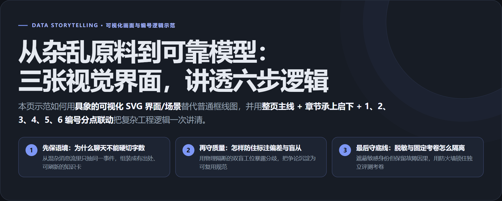
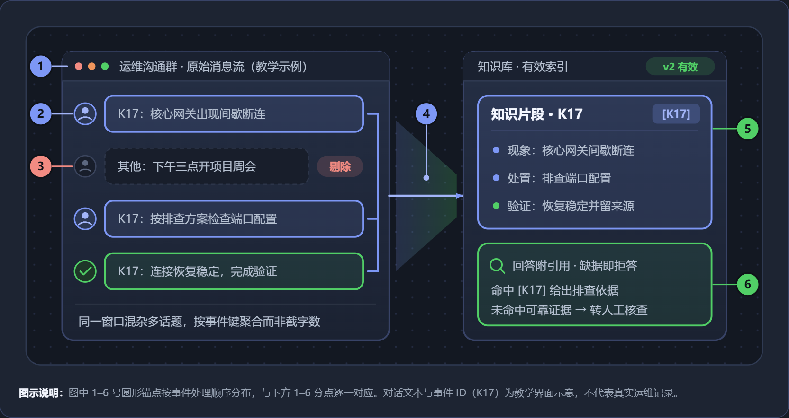
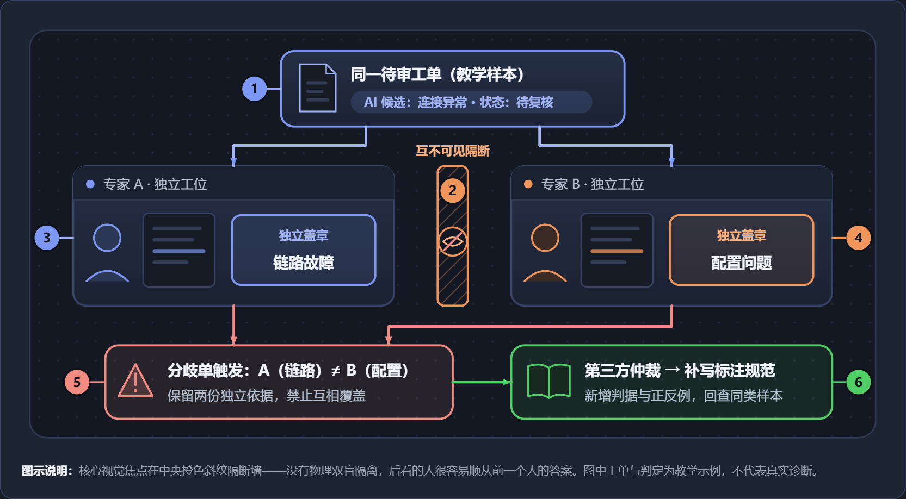
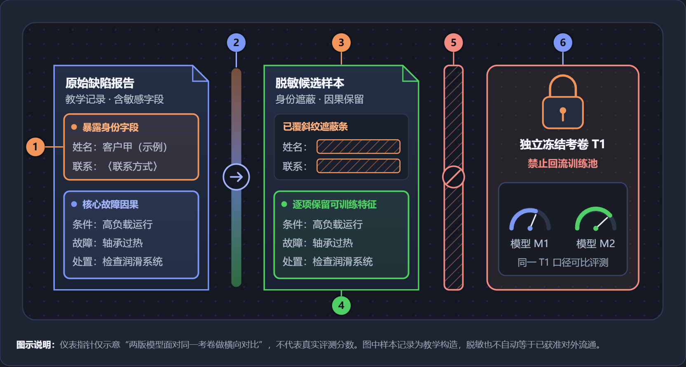
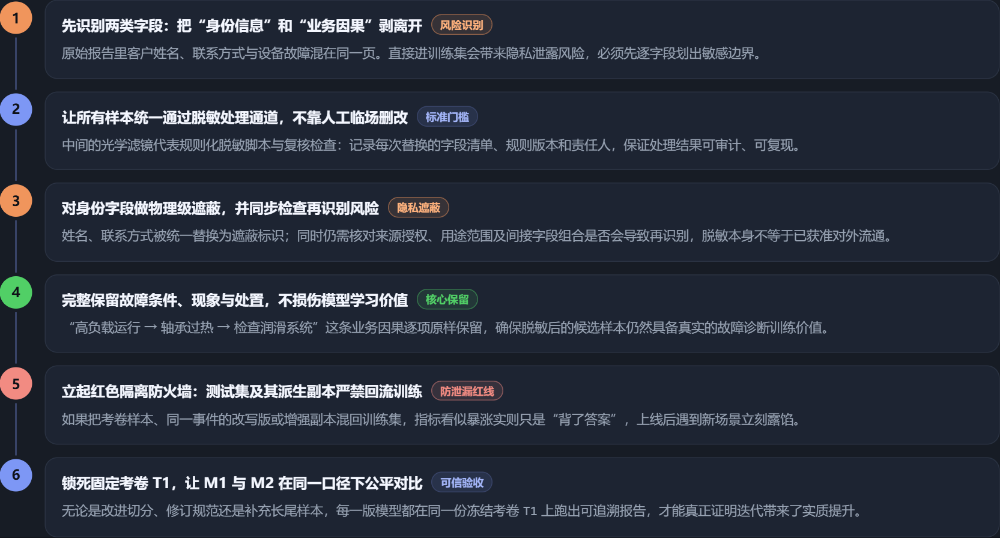

# YD 图文叙事整理

**Skill 名称：`data-storytelling`** · 分类：`visualization`（图文叙事与讲解页）

把一段文字、一份记录或一场分享的转写，整理成**逻辑连贯的可视化讲解页**：先立一条 `1 → N` 的因果主线和章与章之间的承上启下，再把每个核心机制画成**具象的可视化 SVG 界面 / 场景 / 隐喻图画**（而不是"几个方框 + 箭头"的流程框线图），画面里的 `1–6` 圆形编号锚点与图下的 `1、2、3、4、5、6` 分点逻辑说明一一联动。用户只需要说"帮我整理这段内容"，不必指定图形类型、配色或布局。

## 能做什么

- **整页逻辑优先**：Hero 处给出可点击的 `1 → N` 逻辑路标，每章开头用一句"承接上章"的引子，结尾用收束判断引出下一章，杜绝"一堆孤立小图 + 零散文字块"的堆砌。
- **反框线图**：每张 SVG 必须通过"去字可辨检验"——把全部中文抹掉后，读者依然能认出画面呈现的是聊天窗口、代码 diff 视窗、双盲隔断工位、脱敏遮蔽条、挂锁考卷库还是扫描分拣闸。通不过就推倒重画。
- **图文编号联动**：宽幅主画面（推荐 `920×420` 起）上标 `1–6` 号圆形锚点，图下用 `.logic-points` 按 `1、2、3、4、5、6` 逐点讲清"看见什么 → 为什么 → 边界 → 下一步"；需要局部特写时，把小图嵌进对应分点内部。
- **判断与行动逐项配图**：用具体对象、前后变化和操作产物说明每条判断条件与执行动作，而不是只给编号、图标或文字方框。
- **布局契约 + 几何审计**：节点间距、连线通道、标签避让、最小字号、锚点不越界都有可校验的数值门槛；审计器还会检查图是否退化成框线图（`VISUAL_TOO_SCHEMATIC`）、图内锚点与图外分点是否同步（`LOGIC SYNC`）。
- **窄屏不缩图**：整图缩放会让字号同比缩水，构建脚本按每张图的 viewBox 宽度自动声明最小渲染宽度，窄屏改为横向滚动并给出滑动提示。
- **并行生产**：复杂页面按"一图一个子 Agent"并行，先冻结视觉画面方案（隐喻、道具、编号锚点清单）再开工，每图最多两轮几何修复，最后一次整页验收。

## 输入、流程和输出

| 项目 | 内容 |
| --- | --- |
| 必要输入 | 需要整理或总结的文字、链接、文件或转写内容。 |
| 可选输入 | 指定深色或浅色、只要文字不要图、需要突出的结论、目标文件名。未提供时由技能按内容决定。 |
| 处理流程 | 建立事实表并区分证据等级 → 立整页因果主线与章节承接 → 为每章构思具象视觉画面并做去字可辨自检 → 按布局契约绘制带 1–6 锚点的 SVG → 图外编号分点联动写作 → 并行生产与两轮修复 → 浏览器几何审计、LOGIC SYNC 与整页覆盖核对。 |
| 页面输出 | 可直接打开的单个 HTML 文件（内联 SVG，无远程资源），或对话内的内联图形。 |
| 随附说明 | 一句主结论、逐图解释、加粗的关键判断与注意事项、执行清单、已验证 / 归纳 / 待验证的证据边界。 |

图形与文字不重复同一份信息：画面负责结构与状态，分点文字负责因果、证据、边界和行动建议。材料里没有数量或比例时，不会伪造柱高、百分比和精确坐标；不确定的内容明确标为未知。

## 图片与效果

以下截图取自包内示例页 `examples/visual-story-demo.html`（源文件 `assets/visual-story-demo-body.html`），展示新版"可视化 SVG 画面 + 编号逻辑"的完整效果。

### 整页逻辑路标：先交代因果主线，再进章节



每个路标不是孤立的名词标签，而是一句推进问题；章与章之间另有承接引子，保证整页读下来是一条连续的逻辑线。

### 可视化界面：抹掉文字也认得出这是"聊天窗口 → 知识卡"



画面主体是深色窗口、消息气泡、高亮选区和抽取光束——不是"输入/输出两个方框加箭头"。图中 1–6 号圆形锚点对应图下 1–6 分点。

### 视觉隐喻：把"双盲复核"画成一道物理隔断墙



抽象的组织机制用看得见的机关表达：隔断墙上带"不可互见"的眼睛斜杠徽章，印章不一致触发红色分歧单。

### 前后分屏：脱敏 = 斜纹遮蔽条，隔离 = 红色防火墙



### 编号分点：图内的 1–6 与图外的 1、2、3、4、5、6 一一对应



每个分点带语义角色标签（现状痛点 / 核心机制 / 清洗动作 / 风险边界等），审计器自动核对 SVG 锚点与分点编号是否同步。

## 调用

```text
帮我整理这段内容

我们的答疑记录散在群里和表单里，字段口径不一致，新人接手时经常找不到出处。
先按渠道收齐原始记录，再做去重和脱敏，然后把同名字段对齐到同一含义，
最后发布成可检索、可引用、能定期刷新的知识看板。
```

```text
梳理这份材料，生成一个完整的 HTML 页面
```

只需要提供内容本身。图形类型、拆分粒度、配色和版式都由技能内部决定；想要浅色页或纯文字时说一句即可。

## 包内资源

```text
data-storytelling/
├── SKILL.md
├── README.md
├── agents/openai.yaml
├── references/
│   ├── methodology.md              可视化 SVG 叙事语法与 1–6 分点叙事法
│   ├── visual-svg-cookbook.md       七类可视化原型、视觉隐喻词典与四层质感规范
│   ├── svg-layout-protocol.md       布局契约、编号锚点与语义、证据门槛
│   ├── subagent-orchestration.md   一图一 Agent 的并行生产与五项验收
│   ├── layout-research.md           参考页的排版规律调研
│   └── figure-spec.schema.json     视觉单元登记表结构（含 visualMode 与 callouts）
├── scripts/
│   ├── audit_svg_layout.py         浏览器几何审计、LOGIC SYNC 与整页覆盖核对
│   ├── build_recap.js              深色 / 浅色整页构建
│   ├── assemble_story.js           分片装配完整页面
│   └── lib/viz_min_width.js        按 viewBox 宽度声明最小渲染宽度
├── assets/
│   ├── dark-story.css              深色技术讲解版样式（含 .logic-points / .story-roadmap）
│   ├── visual-story-demo-body.html 新版"可视化画面 + 编号逻辑"示范正文
│   ├── qq-style.css                浅色分享页样式
│   ├── qq-extra.css
│   ├── qq-responsive.css
│   └── layout-contract-demo-body.html  严格布局最小示例
└── examples/
    ├── visual-story-demo.html      新版完整示例（3 张可视化 SVG，桌面 + 移动端审计通过）
    ├── showcase/*.png              README 样图
    ├── demo-dark.html              上一版多案例兼容示例
    ├── demo-dark-body.html
    ├── demo-light.html
    └── demo-light-body.html
```

几何审计需要 Python 与 Playwright（`pip install playwright` 后 `playwright install msedge`，或本机已有 Edge/Chrome）。缺少依赖时技能不会声称已完成几何验证，而会改为逐图人工核对截图并如实标注未验证。

## 使用边界

示例页中的团队、渠道、字段和数值全部为虚构，只用于说明排版方式，不代表任何真实业务或真实指标；整理新材料时不会把示例里的对象与数字带入。

几何审计能保证间距、连线落点、字号、标签避让和图文编号同步，但不能替代语义判断：画面是否真的表达了原文含义、是否通过了"去字可辨检验"，仍需逐图核对原文与渲染截图。深色页适合技术培训与方法论复盘，需要正式对外发布的品牌页面时，应另行确认视觉规范。
