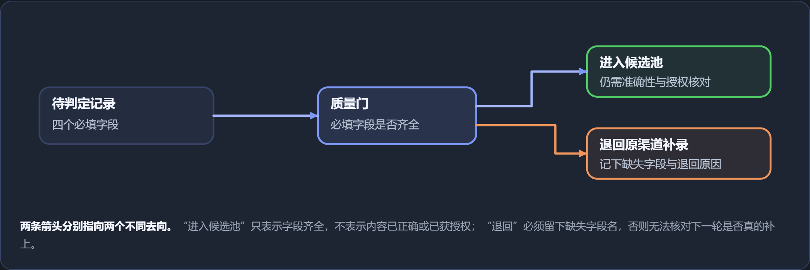

# YD 图文叙事整理

**Skill 名称：`data-storytelling`** · 分类：`visualization`（图文叙事与讲解页）

把一段文字、一份记录或一场分享的转写，整理成“图 + 文”的讲解结构：一句主结论、一张总览主线、每个独立关系单独一张 SVG、逐项配图的判断表与执行清单，最后给出文字解释、证据边界和可执行步骤。用户只需要说“帮我整理这段内容”，不必指定图形类型、配色或布局。

## 能做什么

- 自动按“一个关系一张图”拆分内容，避免把场景、判断规则、执行顺序挤进同一张大图。
- 为判断条件、执行动作逐项配解释图：用具体对象、前后变化和操作产物说明，而不是只给编号、图标或文字方框。
- 输出深色技术讲解页（默认）或浅色分享页；页面自带横向滚动、移动端适配与图注。
- 每张 SVG 执行布局契约：节点间距、连线通道、标签避让、最小字号都有可校验的数值门槛。
- 窄屏不靠缩小整图适配：整图缩放会让字号、线宽和净距同比缩水，构建脚本按每张图的 viewBox 宽度自动声明最小渲染宽度，窄屏改为横向滚动并给出滑动提示。
- 交付前用浏览器几何审计逐图检查，并核对“每块内容是否都有对应的解释图”。
- 复杂页面按“一图一个子 Agent”并行生产，规划一次、并行绘图、每图最多两轮几何修复，最后只做一次整页验收。

## 输入、流程和输出

| 项目 | 内容 |
| --- | --- |
| 必要输入 | 需要整理或总结的文字、链接、文件或转写内容。 |
| 可选输入 | 指定深色或浅色、只要文字不要图、需要突出的结论、目标文件名。未提供时由技能按内容决定。 |
| 处理流程 | 建立事实表并区分证据等级 → 拆成独立关系的视觉单元 → 为每个单元选最贴合的图形 → 按布局契约绘制 SVG → 并行生产与两轮修复 → 浏览器几何审计与整页覆盖核对。 |
| 页面输出 | 可直接打开的单个 HTML 文件（内联 SVG，无远程资源），或对话内的内联图形。 |
| 随附说明 | 一句主结论、逐图解释、加粗的关键判断与注意事项、执行清单、已验证 / 归纳 / 待验证的证据边界。 |

图形与文字不重复同一份信息：图负责结构与关系，文字负责证据、边界和行动建议。材料里没有数量或比例时，不会伪造柱高、百分比和精确坐标；不确定的内容明确标为未知。

## 图片与效果

下面两张取自包内的虚构示例页 `examples/demo-dark.html`，展示同一套深色线稿语汇下的两种典型关系：一张交代主线，一张交代分叉判断。

### 主线总览：一条流程只回答“主线是什么”


字段怎样对齐、不合格记录怎样退回，交给后面的图展开，不在这张图里堆叠。

### 分叉判断：两条箭头指向两个不同去向



图注同时写清边界：“进入候选池”只表示字段齐全，不表示内容已正确或已获授权。

## 调用

```text
帮我整理这段内容

我们的答疑记录散在群里和表单里，字段口径不一致，新人接手时经常找不到出处。
先按渠道收齐原始记录，再做去重和脱敏，然后把同名字段对齐到同一含义，
最后发布成可检索、可引用、能定期刷新的知识看板。
```

```text
梳理这份材料，生成一个完整的 HTML 页面
```

只需要提供内容本身。图形类型、拆分粒度、配色和版式都由技能内部决定；想要浅色页或纯文字时说一句即可。

## 包内资源

```text
data-storytelling/
├── SKILL.md
├── README.md
├── agents/openai.yaml
├── references/
│   ├── methodology.md              高质量数据与微调的数据建设方法论
│   ├── svg-layout-protocol.md      布局契约与语义、证据门槛
│   ├── subagent-orchestration.md   一图一 Agent 的并行生产与验收
│   ├── layout-research.md          参考页的排版规律调研
│   └── figure-spec.schema.json     视觉单元登记表结构
├── scripts/
│   ├── audit_svg_layout.py         浏览器几何审计与整页覆盖核对
│   ├── build_recap.js              深色 / 浅色整页构建
│   ├── assemble_story.js           分片装配完整页面
│   └── lib/viz_min_width.js        按 viewBox 宽度声明最小渲染宽度
├── assets/
│   ├── dark-story.css              深色技术讲解版样式
│   ├── qq-style.css                浅色分享页样式
│   ├── qq-extra.css
│   ├── qq-responsive.css
│   └── layout-contract-demo-body.html  严格布局最小示例
└── examples/
    ├── demo-dark.html              深色完整示例（6 张契约 SVG）
    ├── demo-dark-body.html
    ├── demo-light.html             浅色完整示例
    ├── demo-light-body.html
    └── showcase/*.png              README 样图
```

几何审计需要 Python 与 Playwright（`pip install playwright` 后 `playwright install msedge`，或本机已有 Edge/Chrome）。缺少依赖时技能不会声称已完成几何验证，而会改为逐图人工核对截图并如实标注未验证。

## 使用边界

示例页中的团队、渠道、字段和数值全部为虚构，只用于说明排版方式，不代表任何真实业务或真实指标；整理新材料时不会把示例里的对象与数字带入。

几何审计能保证间距、连线落点、字号和标签避让，但不能替代语义判断：图形是否真的表达了原文含义，仍需逐图核对原文、图中可见事实与结论。深色页适合技术培训与方法论复盘，需要正式对外发布的品牌页面时，应另行确认视觉规范。
